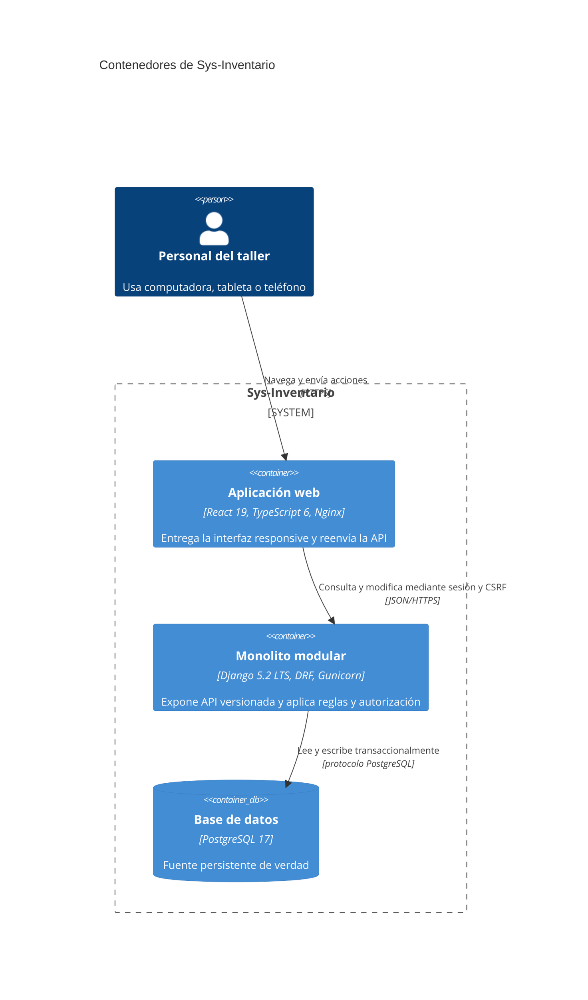

# C4 nivel 2: contenedores

Cada contenedor es una unidad ejecutable; los módulos internos de Django no son microservicios.
Consulte la [referencia terminológica](c4-containers-glossary-reference.md).
