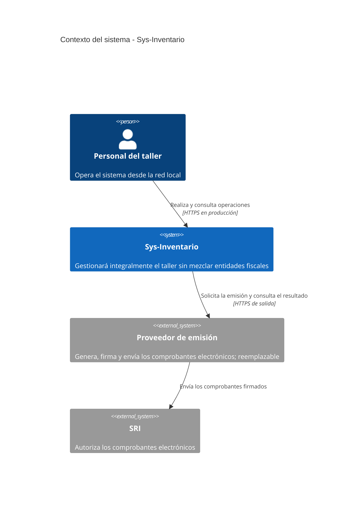

# C4 nivel 1: contexto

En V1 no existen usuarios públicos. La facturación electrónica (`DP-034`) añade dos sistemas
externos: un proveedor de emisión, que Tallkit consulta solo mediante conexiones de salida, y el
SRI, con el que Tallkit no se comunica directamente. Esa conexión aún no existe: hasta que se
archiven los cambios 3 y 4 de `docs/cambios-pendientes.md` el sistema opera solo en pruebas. La
aplicación anterior queda fuera del sistema. El personal opera información compartida de
clientes y vehículos, pero las operaciones económicas de los RUC comercial y artesanal permanecen
separadas. El detalle se define en el [modelo conceptual del dominio](../arquitectura/modelo-dominio.md).
