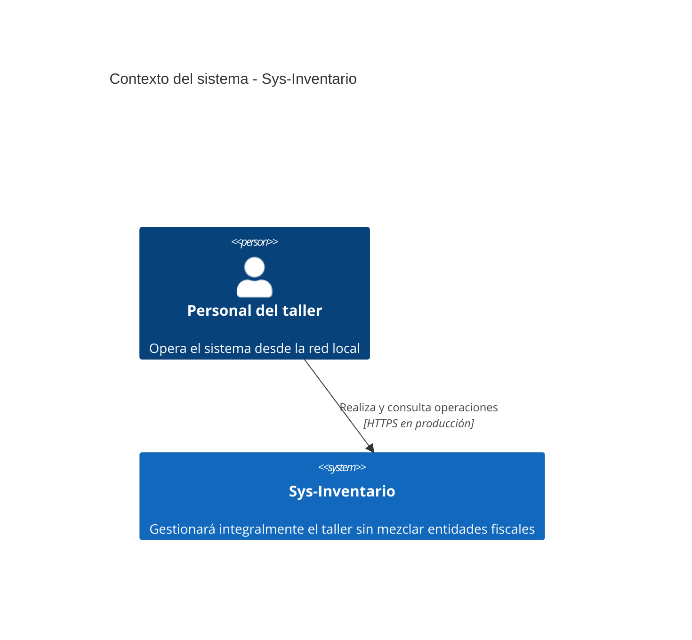

# C4 nivel 1: contexto

En V1 no existen usuarios públicos ni integraciones externas. La aplicación anterior y el SRI
quedan fuera del sistema. Consulte la [referencia terminológica](c4-context-glossary-reference.md).
