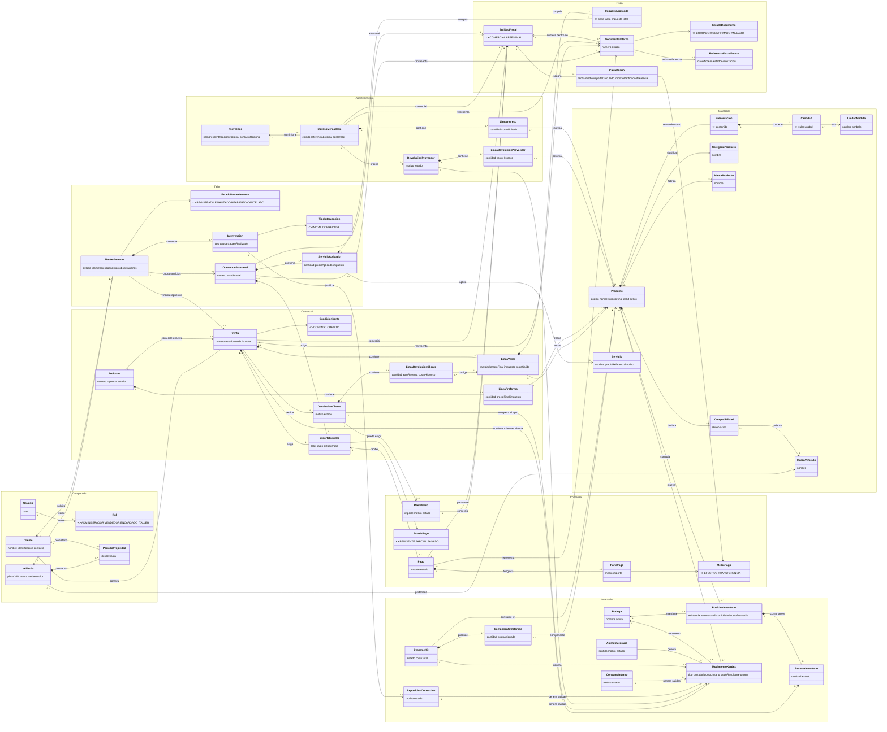

# Modelo conceptual del dominio del taller

| Campo | Valor |
|---|---|
| Producto | Sistema de gestión integral para taller automotriz |
| Versión | 1.0 |
| Estado | Aprobado como base conceptual; no es un modelo de datos |
| Fecha | 2026-09-08 |

## 1. Propósito y alcance

Este documento define el lenguaje y las responsabilidades del **modelo de dominio** del taller antes de diseñar persistencia o especificaciones funcionales por módulo. Describe qué representa el negocio, qué reglas siempre deben cumplirse y cómo se relacionan sus operaciones.

No propone tablas, claves foráneas, modelos Django, migraciones, endpoints ni componentes. Tampoco crea `modelo-datos.md`. Las clasificaciones técnicas aquí usadas orientan el análisis futuro, pero no obligan a convertir cada concepto en una tabla.

V1 abarca clientes, vehículos, catálogos, ingresos, una bodega, inventario y Kardex, proformas, ventas, crédito simple, pagos, devoluciones, mantenimientos, consumos internos, correcciones, documentos internos, reportes y cierres. Quedan fuera la contabilidad general, cuentas por pagar, facturación electrónica real, conciliación bancaria, planes de pago, garantías completas, kits armados con piezas sueltas y multibodega operativa.

## 2. Fuentes consultadas y precedencia

Se leyeron los documentos vigentes bajo `docs/`, excepto que `docs/negocio/historico/` se consultó solo para reconocer su carácter histórico y nunca como arquitectura objetivo ni requisito vigente.

La precedencia aplicada es:

1. `docs/negocio/decisiones/decisiones-confirmadas.yaml`.
2. Documentos de producto en `docs/negocio/producto/`.
3. Requisitos en `docs/negocio/requisitos/`.
4. Arquitectura vigente en `docs/arquitectura/`, `docs/architecture/` y `docs/tecnico/`.
5. El código existente únicamente como evidencia del estado actual.

Este modelo concreta además el cambio OpenSpec `consolidar-modelo-dominio-taller`, aprobado después de la entrevista de dominio. No se preserva por defecto ningún comportamiento del antiguo sistema Flutter.

## 3. Contextos del negocio

| Contexto | Responsabilidad |
|---|---|
| Identidad y autorización | Usuarios, roles fijos y permisos derivados. |
| Personas y vehículos | Identidad compartida de clientes, vehículos e historia de propiedad. |
| Catálogos | Productos, presentaciones, marcas, compatibilidades y servicios referenciales. |
| Abastecimiento | Proveedores, ingresos y devoluciones a proveedor. |
| Inventario | Existencia, reservas, disponibilidad, Kardex, costos, ajustes, desarmes y salidas especiales. |
| Comercial | Proformas, ventas de repuestos, devoluciones de cliente e importes exigibles del RUC comercial. |
| Taller | Mantenimientos, intervenciones y servicios del RUC artesanal. |
| Cobranza | Pagos, abonos, reembolsos y saldos, siempre dentro de una entidad fiscal. |
| Documentos y control | Numeración interna, futura referencia SRI, auditoría, reportes y cierres diarios. |

Los contextos colaboran mediante referencias explícitas. En particular, un mantenimiento artesanal puede referenciar ventas comerciales, pero no las contiene ni mezcla sus valores.

## 4. Glosario esencial

| Concepto | Significado en este dominio |
|---|---|
| Entidad fiscal | Uno de los dos contribuyentes independientes: comercial o artesanal. |
| Producto | Bien inventariable que se compra y vende como una presentación completa. |
| Servicio | Trabajo del taller sin existencia física; su precio de catálogo es referencial. |
| Presentación | Cantidad cerrada en la que un producto se controla y vende, por ejemplo un galón o medio galón. |
| Cantidad | Valor decimal acompañado por una unidad de medida compatible. |
| Existencia | Cantidad física registrada de un producto en la bodega. |
| Reserva | Cantidad asignada temporalmente a la venta abierta de un mantenimiento; no es una salida. |
| Disponibilidad | Existencia menos reservas vigentes; se calcula, no se corrige directamente. |
| Kardex | Historia inmutable de movimientos que explica las variaciones de existencia. |
| Costo promedio | Valor unitario ponderado recalculado por entradas válidas. |
| Proforma | Oferta temporal que no reserva inventario, crea deuda ni confirma una venta. |
| Venta | Operación comercial que al confirmarse congela valores, crea el importe exigible y produce salidas. |
| Crédito | Condición de venta que permite saldo pendiente; no es un medio de pago. |
| Pago | Aplicación de dinero a una sola operación confirmada mediante efectivo, transferencia o ambos. |
| Mantenimiento | Caso operativo completo de atención de un vehículo, compuesto por una intervención inicial y posibles correcciones. |
| Intervención | Registro de trabajo realizado dentro de un mantenimiento, inicial o correctivo. |
| Documento interno | Representación numerada de una operación del sistema; no es factura electrónica autorizada. |
| Reposición por corrección | Salida de inventario asumida por el taller para corregir una falla atribuible a su trabajo. |
| Consumo interno | Salida de una presentación para uso del taller, sin venta al cliente. |
| Cierre diario | Conciliación lógica por fecha, entidad fiscal y medio de pago. |

El glosario de negocio ampliado se mantiene en `../negocio/producto/glosario.md`.

## 5. Clasificación de conceptos

### 5.1 Entidades y catálogos

- **Entidad fiscal**, **Usuario**, **Cliente**, **Vehículo**, **Proveedor**, **Producto**, **Servicio** y **Bodega** conservan identidad e historia propia.
- **Categoría de producto**, **Marca de producto**, **Marca de vehículo** y **Unidad de medida** son catálogos administrables. Una compatibilidad producto–marca de vehículo sirve para búsqueda y no bloquea una venta.
- El Vehículo tiene exactamente un propietario vigente y conserva períodos anteriores de propiedad. El cliente histórico de cada mantenimiento no cambia por una transferencia posterior.
- El Proveedor es deliberadamente liviano: el nombre es obligatorio; identificación y contacto son opcionales. Es requerido al confirmar un ingreso, aunque sea una persona ocasional.

### 5.2 Objetos de valor

- **Cantidad**: valor y unidad; debe ser positiva en líneas confirmables.
- **Dinero**: importe decimal y moneda.
- **Desglose de impuesto**: base, tarifa, impuesto y total históricos.
- **Presentación**: cantidad cerrada vendible. Un galón y medio galón son productos distintos si ambos se venden cerrados.
- **Período de propiedad**: propietario, inicio y fin opcional.
- **Referencia externa**: número o descripción de factura de compra y evidencias opcionales.

Estos objetos expresan valores del negocio; su forma futura de almacenamiento no se decide aquí.

### 5.3 Documentos y operaciones

- **Ingreso de mercadería**, **Venta**, **Devolución de cliente**, **Devolución a proveedor**, **Ajuste**, **Desarme de kit**, **Consumo interno**, **Reposición por corrección**, **Pago**, **Reembolso**, **Operación artesanal**, **Mantenimiento** y **Cierre diario** son operaciones trazables.
- **Proforma** es un documento comercial previo sin efectos definitivos.
- **Movimiento de Kardex** registra el efecto físico confirmado; no sustituye a la operación que lo originó.
- **Documento interno** representa una operación confirmada y recibe numeración de su entidad fiscal y tipo.
- **Referencia fiscal futura** representa el eventual proceso del SRI con estados propios; no gobierna inventario, pago ni mantenimiento.

## 6. Agregados y responsabilidades

Un agregado marca el conjunto que debe conservar consistencia en una misma acción de negocio; no implica una tabla única.

| Raíz del agregado | Contenido o referencias | Responsabilidad principal |
|---|---|---|
| Cliente | Datos compartidos | Mantener una identidad utilizable por ambos RUC. |
| Vehículo | Períodos de propiedad | Garantizar un solo propietario vigente y conservar la historia. |
| Producto | Presentación y referencias de catálogo | Definir la unidad vendible sin contener existencias ni movimientos. |
| Ingreso de mercadería | Líneas, proveedor y referencia externa | Al confirmar, crear entradas y recalcular costo promedio atómicamente. |
| Inventario por producto y bodega | Existencia y reservas vigentes | Impedir existencia o disponibilidad negativa. |
| Operación de inventario | Líneas y motivo/origen | Producir movimientos trazables sin modificar movimientos previos. |
| Proforma | Líneas y vigencia | Mantener una oferta sin reservar ni crear deuda; convertir una sola vez. |
| Venta | Líneas, condición, impuestos e importe exigible | Congelar valores y costo, consumir reservas si aplica y generar salidas al confirmar. |
| Mantenimiento | Intervenciones y referencias a operaciones económicas | Conservar el caso operativo sin mezclar RUC ni finalizar con repuestos pendientes. |
| Operación artesanal | Servicios aplicados e importe exigible | Cobrar servicios del RUC artesanal con valores históricos. |
| Pago | Partes por medio de pago | Aplicar un importe a una sola operación y una sola entidad fiscal. |
| Cierre diario | Totales y diferencia | Conciliar cobros por entidad fiscal y medio sin editar pagos. |

Los límites exactos de transacción, bloqueo e idempotencia se decidirán en el diseño técnico de cada capacidad. La coordinación futura de reserva, confirmación y Kardex es candidata a ADR por ser transversal y costosa de cambiar; las reglas de negocio de este documento no requieren un ADR propio.

## 7. Estados y transiciones

| Concepto | Estados relevantes | Transiciones permitidas |
|---|---|---|
| Ingreso | borrador, confirmado, anulado | borrador → confirmado; confirmado → anulado mediante compensación. |
| Proforma | borrador, vigente, vencida, convertida, anulada | borrador → vigente; vigente → convertida o vencida; una vencida origina otra vinculada. |
| Venta | borrador, confirmada, anulada | borrador → confirmada; confirmada → anulada mediante operación compensatoria. |
| Pago de operación | pendiente, parcial, pagado | Se deriva del importe exigible y de los pagos netos de correcciones; el reembolso liquida un exceso. |
| Mantenimiento | registrado, finalizado, reabierto, cancelado | registrado → finalizado o cancelado; finalizado → reabierto por corrección; reabierto → finalizado. |
| Intervención | inicial, correctiva | La inicial no se reemplaza; cada reapertura atribuible añade una correctiva. |
| Documento interno | borrador, confirmado, anulado | La confirmación asigna número; la anulación conserva original. |
| Referencia fiscal futura | no emitida, en proceso, autorizada, rechazada, anulada | Ciclo independiente, fuera de V1. |

Cancelar un mantenimiento se limita a duplicados, errores o casos sin trabajo cobrable. Un trabajo parcial que ya debe cobrarse se finaliza. Reabrir no es editar libremente el estado.

## 8. Invariantes del dominio

1. Toda operación económica pertenece a exactamente una entidad fiscal.
2. Servicios y repuestos nunca comparten documento, pago, saldo, numeración, cierre ni reporte económico.
3. Clientes, vehículos y usuarios se comparten entre los dos RUC.
4. Un vehículo tiene un solo propietario vigente; su historia anterior se conserva.
5. Producto y servicio son catálogos distintos.
6. V1 controla una sola bodega y nunca admite existencia ni disponibilidad negativa.
7. Toda variación real de existencia tiene un movimiento de Kardex inmutable y un origen trazable.
8. Una reserva reduce disponibilidad, no existencia, y nunca genera Kardex.
9. Solo la venta abierta vinculada a un mantenimiento reserva; proformas y ventas directas en borrador no reservan.
10. Cada mantenimiento puede tener como máximo una venta vinculada abierta, aunque conserve varias confirmadas.
11. Un mantenimiento no finaliza mientras esa venta abierta contenga líneas; finalizar no confirma una venta.
12. Un kit se vende intacto o se desarma explícitamente; el desarme consume el kit, produce componentes y conserva exactamente el costo total.
13. V1 no arma productos kit desde piezas sueltas; puede vender dichas piezas como líneas independientes.
14. Confirmar una venta congela precio final, base, tarifa, impuesto, total y costo de salida históricos.
15. Cambiar precios o impuestos del catálogo nunca modifica operaciones confirmadas.
16. Crédito es saldo pendiente, no medio de pago; no tiene cuotas, intereses, vencimientos ni plan.
17. Cada pago se aplica a una sola operación confirmada, no admite anticipos ni sobrepagos y no cruza RUC.
18. La devolución no supera lo vendido pendiente de devolver. Solo lo apto reingresa con el costo histórico de salida.
19. Un exceso pagado por devolución requiere reembolso; no crea saldo a favor.
20. Los documentos y movimientos confirmados no se editan ni eliminan: se corrigen con operaciones compensatorias.
21. El trabajo y los repuestos de una corrección atribuible al taller no crean deuda al cliente.
22. Un producto aportado por el cliente no entra al inventario ni genera venta; solo puede mencionarse en observaciones.
23. El consumo interno descuenta una presentación completa y no se distribuye entre mantenimientos.
24. V1 no acepta descuentos en proformas, ventas, servicios ni mantenimientos.
25. Un documento interno no se presenta como factura electrónica autorizada por el SRI.

## 9. Eventos relevantes del negocio

- Ingreso confirmado o anulado.
- Costo promedio recalculado.
- Existencia reservada o reserva liberada.
- Venta confirmada o anulada.
- Proforma convertida o vencida.
- Pago registrado o corregido.
- Devolución aceptada y producto clasificado como apto o no apto.
- Reembolso registrado.
- Kit desarmado.
- Consumo interno o devolución a proveedor confirmados.
- Mantenimiento registrado, finalizado, reabierto o cancelado.
- Intervención correctiva registrada y reposición por corrección confirmada.
- Documento interno numerado.
- Cierre diario confirmado o corregido.

Estos eventos son hechos conceptuales. Este documento no ordena implementar mensajería ni una arquitectura orientada a eventos.

## 10. Conceptos calculados

No deben almacenarse innecesariamente como hechos independientes:

- disponibilidad = existencia − reservas vigentes;
- saldo pendiente = importe exigible vigente − pagos aplicados netos de sus correcciones; un reembolso liquida un exceso pagado, no crea deuda nueva;
- estado de pago derivado del saldo;
- cantidad todavía devolvible = vendida − devoluciones válidas previas;
- totales de cierre derivados de pagos válidos de la misma fecha, entidad y medio;
- margen bruto histórico = importe neto histórico de venta − costo histórico de salida.

La existencia actual puede mantenerse como saldo operativo por concurrencia y rendimiento, pero siempre debe poder conciliarse con el Kardex. El margen bruto no es ganancia neta ni contabilidad completa.

## 11. Decisiones, contradicciones y asuntos abiertos

### 11.1 Decisiones adoptadas

Se adoptaron las decisiones `DP-001` a `DP-004`, `DP-007` a `DP-021`, `CT-001` y la interpretación V1 de `DM-003` registradas en la fuente prioritaria. Entre ellas destacan una bodega, stock no negativo, efectivo y transferencia, ausencia de descuentos, reapertura controlada, presentaciones completas, kits comprados, proveedor mínimo obligatorio, reserva exclusiva de mantenimiento, crédito y pagos simples, devolución con inspección, correcciones sin cargo, documentos internos y cierres separados.

### 11.2 Recomendaciones todavía no aprobadas

- Definir en una especificación futura una política decimal y de redondeo compatible con la normativa aplicable.
- Definir mediante diseño técnico y, si aparecen alternativas relevantes, un ADR para la coordinación transaccional entre reservas, confirmación de venta y Kardex.
- Conservar una abstracción conceptual de bodega aunque V1 habilite solo una, sin construir transferencias ni pantallas multibodega.

Estas recomendaciones no autorizan implementación.

### 11.3 Contradicciones corregidas

- Se retiró la posibilidad de descuentos y sus autorizaciones antiguas.
- Una sola bodega y la prohibición de stock negativo dejaron de figurar como pendientes.
- Efectivo y transferencia sustituyeron el catálogo abierto de medios de pago; crédito quedó como condición.
- La reapertura dejó de estar deshabilitada: ahora es una acción explícita por corrección.
- Finalizar un mantenimiento ya no deja silenciosamente repuestos reservados ni confirma su venta.
- “Responsable del vehículo” se reemplazó por propietario vigente con historia.
- La devolución dejó de producir saldo a favor y distingue aptitud para reventa.
- El documento interno quedó diferenciado de la factura electrónica autorizada.

### 11.4 Decisiones aplazadas

- `DP-006`: formato visible, prefijos y series exactas de secuenciales internos.
- `DA-002`: límites, almacenamiento y conservación de fotografías.
- `DA-003`: instalación, actualización, respaldo y restauración local.
- `DM-001`: estructura técnica común o separada de documentos económicos.

### 11.5 Información insuficiente o validación externa

- Tratamiento fiscal y contable de consumos internos y reposiciones sin cargo entre los dos contribuyentes.
- Tarifas y clasificación tributaria reales de productos y servicios.
- Reglas de redondeo, consumidor final y futuros requisitos de facturación electrónica en Ecuador.

Estos puntos afectan obligaciones reales y deben validarse con un contador y la normativa ecuatoriana vigente; el modelo no los presenta como asesoría tributaria.

## 12. Diagrama único de clases del dominio

El diagrama usa agrupaciones conceptuales. Las composiciones indican partes que carecen de sentido fuera de su operación; las asociaciones entre contextos no implican propiedad técnica ni claves foráneas.

## 13. Explicación sencilla del diagrama

La zona compartida contiene personas y vehículos. Los dos RUC usan esas mismas fichas, pero desde allí el dinero se separa: los repuestos siempre avanzan por Venta y los servicios por Operación artesanal.

Producto describe qué se vende; Posición de inventario dice cuánto hay; Reserva aparta temporalmente una cantidad; Movimiento de Kardex explica una entrada o salida ya ocurrida. Por eso ninguno sustituye a los otros. Los kits comprados existen como productos completos hasta que un Desarme explícito los transforma en componentes.

Mantenimiento agrupa la historia del trabajo mediante intervenciones. Puede enlazar varias ventas comerciales confirmadas a medida que aparecen repuestos adicionales, pero solo una venta puede quedar abierta y reservar a la vez. Una corrección atribuible reabre el mismo mantenimiento, agrega una intervención y puede justificar una salida sin cargo.

Venta y Operación artesanal crean importes exigibles independientes. Los pagos reducen un solo importe y un solo RUC. El documento interno da representación y número a la operación; una futura autorización del SRI sería otra referencia con su propio ciclo.

## 14. Trazabilidad

| Aspecto del modelo | Decisiones | Reglas y requisitos principales |
|---|---|---|
| Separación fiscal y datos compartidos | CT-001 | RN-FIS-001…010; RF-ACC-010; RF-TAL-007…012 |
| Propiedad de vehículo | DM-003 V1 | RN-CLI-004…008; RF-CLI-006…011 |
| Presentaciones, marcas y kits | DP-009, DP-010 | RN-CAT-001…014; RF-CAT-001…016; RF-INV-016 |
| Proveedor e ingresos | DP-011 | RN-CAT-010…013; RN-INV-003…007; RF-INV-001…005, RF-INV-014 |
| Existencia, reserva y Kardex | DP-001, DP-002, DP-012 | RN-INV-001…023; RF-INV-006…019 |
| Proformas y ventas | DP-004, DP-017, DP-021 | RN-PRO-001…009; RN-VEN-001…018; RF-PRO-*; RF-VEN-* |
| Crédito, pagos y devoluciones | DP-003, DP-013, DP-014 | RN-VEN-008…016; RF-PAG-*; RF-VEN-012…018 |
| Mantenimiento y correcciones | DP-007, DP-015, DP-016, DP-020, DP-021 | RN-TAL-001…023; RF-TAL-001…020 |
| Documentos, cierres y reportes | DP-018, DP-019 | RN-CON-001…012; RF-REP-001…014; RF-AUD-* |

La trazabilidad detallada entre reglas, requisitos, casos de uso e interfaz se encuentra en `../negocio/requisitos/matriz-trazabilidad.md` y la especificación de aceptación documental en `../../openspec/changes/consolidar-modelo-dominio-taller/specs/modelo-dominio-taller/spec.md`.
