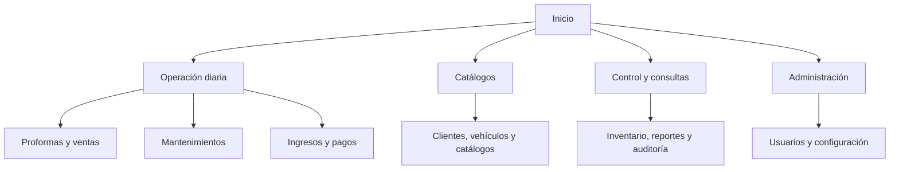
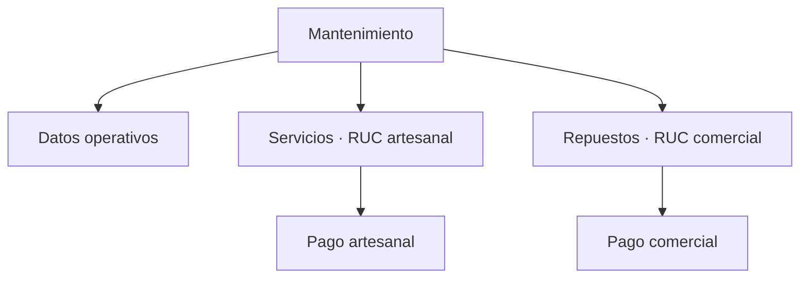

# Requisitos de interfaz y navegación

| Campo | Valor |
|---|---|
| Producto | Sistema de gestión integral para taller automotriz |
| Nombre técnico provisional | Sys-Inventario |
| Versión del documento | 0.5 |
| Estado | Modelo de dominio aprobado; sistema visual Tallkit aplicado, pendiente de aceptación visual final |
| Fecha | 2026-09-23 |

> Este documento define estructura, pantallas y comportamiento esperado. El sistema visual propio **Tallkit · Banco de trabajo**, sus tokens y componentes se documentan en [`../../../DESIGN.md`](../../../DESIGN.md); los patrones de pantalla PPF-01…PPF-08 están en la capacidad `patrones-de-pantalla-frontend` (hoy en `openspec/changes/redisenar-sistema-visual-tallkit/specs/`, y en `openspec/specs/` al archivar el cambio).

## 1. Principios de interfaz

1. Mostrar solo módulos y acciones permitidos, sin sustituir la autorización del backend.
2. Usar los términos definidos en `../producto/glosario.md`.
3. Identificar claramente la **entidad fiscal**, comercial o artesanal, en toda operación económica.
4. Mantener separados estado de venta, estado de pago, estado del documento interno y eventual referencia fiscal.
5. Favorecer búsqueda y selección rápida en los flujos diarios.
6. Evitar la edición destructiva de documentos confirmados; mostrar las acciones de corrección disponibles.
7. Ser adaptable a computadora, tableta y teléfono.
8. Mostrar el efecto de confirmar, anular, devolver o ajustar antes de ejecutar la acción.
9. Conservar contexto al volver desde una ficha a una lista filtrada.
10. No depender únicamente del color para estados, alertas o errores.

## 2. Estructura global

### 2.1 Marco de aplicación

La aplicación autenticada tendrá:

- Marca **Tallkit** con el logotipo del producto, usuario actual, roles y cierre de sesión al pie de la navegación. El acceso a perfil se incorporará cuando exista esa capacidad.
- Navegación principal agrupada por área de trabajo, según el tamaño:
  - desde 1280 px, barra lateral desplegada de 240 px con iconos y etiquetas;
  - de 768 a 1279 px, barra compacta de iconos de 72 px con nombre accesible y ayuda emergente;
  - por debajo de 768 px, barra superior con menú y un panel temporal de navegación que se cierra al elegir.
- Barra superior de escritorio con la ruta de migas; no incluye búsqueda global.
- Título de página y contexto breve cuando resulte útil.
- Área principal de contenido, a todo el ancho disponible.
- Indicador visible de entidad fiscal (nombre, icono y tono propios de cada RUC) en la barra superior cuando la pantalla tenga ámbito económico.
- Zona de notificaciones temporales abajo a la derecha para confirmar acciones terminadas (sección 8.2). Las advertencias y los errores permanecen en línea junto a lo afectado.

Los recursos tipográficos e iconográficos esenciales se sirven desde el paquete local. Los controles táctiles esenciales tienen al menos 44 px; el foco es visible y el movimiento respeta `prefers-reduced-motion`. Las tablas comparables se mantienen en computadora y tableta, mientras el teléfono prioriza identificación, estado y acciones sin provocar desplazamiento horizontal de la página.

### 2.2 Navegación principal propuesta

La presentación exacta puede cambiar durante el prototipado, pero debe evitar una navegación separada y duplicada para los dos RUC. La entidad fiscal se deriva del proceso: repuestos corresponden al RUC comercial y servicios al artesanal.

## 3. Inicio y acceso rápido

### UI-001 — Inicio de sesión

- Usuario o identificador.
- Contraseña con opción para mostrar temporalmente.
- Acción principal “Iniciar sesión”.
- Mensaje genérico para credenciales inválidas.
- Indicación de bloqueo o recuperación administrativa sin revelar si una cuenta específica existe.

### UI-002 — Página de inicio

Debe mostrar únicamente información permitida al usuario:

- Accesos rápidos según rol: nueva venta, nueva proforma, nuevo mantenimiento, nuevo ingreso y registrar pago.
- Alertas de stock bajo para roles autorizados.
- Saldos pendientes separados por RUC para quien pueda consultarlos.
- Mantenimientos registrados pendientes de finalizar.
- Estado básico del respaldo solo para el Administrador.

Los indicadores no deben reemplazar los reportes ni mezclar totales fiscales.

## 4. Patrón de listas

Todas las listas principales deben ofrecer, según el dato:

- Búsqueda de texto con etiqueta clara.
- Filtros combinables y acción para limpiarlos.
- Ordenamiento por columnas pertinentes.
- Paginación del lado del servidor.
- Conteo de resultados.
- Acción primaria visible para crear, si existe permiso.
- Menú de acciones por fila según estado y permiso.
- Estado textual acompañado de distintivo visual.
- Estado vacío que explique qué hacer.
- Estado de carga y error con opción de reintento seguro.
- Exportación solo cuando esté definida para la pantalla.

En teléfono se mostrarán primero identificador, nombre o documento, estado, total y acción principal. Los demás datos podrán aparecer en una vista expandida o ficha.

## 5. Patrón de formularios

- Agrupar campos por significado, no por estructura de base de datos.
- Marcar campos obligatorios antes de enviar.
- Validar formato al salir del campo y reglas completas al guardar.
- Mostrar errores junto al campo y un resumen al inicio cuando existan varios.
- Conservar los valores ingresados después de un error recuperable.
- Advertir antes de abandonar cambios no guardados.
- Diferenciar `Guardar borrador` de `Confirmar`.
- Deshabilitar doble envío mientras se procesa una acción crítica.
- Indicar por qué una acción está deshabilitada cuando sea útil.
- Mostrar importes con moneda y precisión consistentes.

## 6. Pantallas por módulo

### 6.1 Usuarios y configuración

| ID | Pantalla | Contenido y acciones esenciales |
|---|---|---|
| UI-010 | Lista de usuarios | Búsqueda, estado, rol, último acceso cuando esté disponible, crear, editar, activar/desactivar y restablecer credencial. |
| UI-011 | Formulario de usuario | Identificación de acceso, datos básicos, estado y selección de uno o más roles entre Administrador, Vendedor y Encargado del taller. |
| UI-013 | Configuración del taller | Página exclusiva del Administrador presentada como una sola hoja que, desde 768 px, ocupa todo el alto disponible sin cambiar de altura entre secciones; la descripción del encabezado ocupa una línea. Una navegación de secciones con enlaces (*Entidades fiscales*, *Bodega*, *Impuestos*, *Series y numeración*, *Facturación electrónica*), vertical desde 1024 px y barra horizontal desplazable por debajo, muestra registros y pendientes de cada sección y marca la posición con `aria-current`; se recorre con Tab. Inicia en *Entidades fiscales* salvo enlace directo (`?tab=`, `?seccion=`, `?entidad=`). El encabezado resume los pendientes de configuración con un enlace a la subsección que los resuelve. Cada sección se consulta primero (filas y tablas agrupadas por entidad con placa de RUC) y se edita solo en modales; los errores quedan en el modal o la sección de origen. |
| UI-014 | Entidades fiscales | Pestañas o fichas independientes para RUC comercial y artesanal; nunca un formulario económico combinado. |
| UI-015 | Impuestos y vigencias | Lista cronológica por entidad fiscal, tarifa, fecha inicial y final; crear nueva vigencia. |
| UI-016 | Series y secuenciales | Entidad, tipo, serie, valor actual y estado; muestra COM-ING, COM-PRO y COM-VEN bajo el RUC comercial y ART-SER bajo el artesanal, con vista `<SERIE>-<SECUENCIAL>` de al menos seis dígitos y sustitución explícita de una serie usada. |
| UI-017 | Parámetros | Formas de pago, umbrales y valores configurables aprobados. |
| UI-019 | Facturación electrónica | El título es la subsección actual (nombre completo, descripción breve e icono en el tono del ámbito seleccionado); junto a él, la insignia «Preparación local» con el aviso permanente y un indicador de advertencia con los pendientes, ambos con detalle desplegable con puntero, foco o toque. Selector compacto de la entidad fiscal a la derecha (ámbito, razón social y marcador de estado; placa del RUC seleccionado debajo) que reemplaza todos los datos al cambiar. Sin franjas de estado. Subsecciones anidadas en la navegación con nombres breves (*Perfil tributario*, *Puntos de emisión*, *Impuestos SRI*, *Formas de pago*, *Certificado*) e indicadores mínimos; por debajo de 1024 px, en una barra propia. Estados en chips con los tonos del sistema; *Perfil tributario* en tabla con un modal por condición; el certificado como tarjeta con modal amplio (pasos, atajos de duración y vista previa). Códigos, versiones y fuentes en «Información avanzada», plegada. Ambiente único de pruebas. |
| UI-018 | Auditoría | Filtros por usuario, fecha, acción, tipo, identificador y resultado; detalle de evento. |

### 6.2 Clientes y vehículos

| ID | Pantalla | Contenido y acciones esenciales |
|---|---|---|
| UI-020 | Lista de clientes | Búsqueda por nombre, identificación y contacto; estado; acceso a ficha y creación. |
| UI-021 | Ficha de cliente | Datos, vehículos, saldos separados por RUC e historial permitido. |
| UI-022 | Formulario de cliente | Tipo de persona, identificación, nombre o razón social y teléfono obligatorios; email y dirección opcionales; advertencias de coincidencia por nombre o teléfono y rechazo de identificación duplicada con acceso a la ficha existente. |
| UI-023 | Lista de vehículos | Placa, marca, modelo, propietario vigente, estado y último kilometraje. |
| UI-024 | Ficha de vehículo | Datos, propietario vigente, períodos de propiedad, historial cronológico y accesos a mantenimientos. |
| UI-025 | Formulario de vehículo | Placa, marca, modelo y propietario obligatorios; color, año y VIN opcionales; selectores paginados de cliente y marca activos, alta de marca sin perder el borrador y rechazo de placa o VIN duplicados con acceso a la ficha existente. |

### 6.3 Productos, servicios y proveedores

| ID | Pantalla | Contenido y acciones esenciales |
|---|---|---|
| UI-030 | Lista de productos | Código interno, código del fabricante, nombre, categoría, presentación, marca de producto, marcas de vehículo compatibles, precio final, existencia, reserva, disponibilidad y estado. |
| UI-031 | Ficha de producto | Datos, existencia de la bodega principal, reserva, disponibilidad, Kardex, precio y costos según permiso, compatibilidades y opción de desarme si es kit. |
| UI-032 | Formulario de producto | Código interno, código del fabricante (opcional), descripción, categoría, cantidad y unidad de la presentación cerrada, precio final, umbral, marca de producto, tipo kit y compatibilidades informativas. |
| UI-033 | Categorías, marcas y unidades | Gestión separada de categorías, marcas de producto, marcas de vehículo y unidades de medida. Las marcas de vehículo se consultan con `marcas_vehiculo.ver`, se crean y editan con `marcas_vehiculo.gestionar` y se activan o desactivan solo con `marcas_vehiculo.desactivar`, en la ruta `/vehicle-brands`. |
| UI-034 | Lista de servicios | Nombre, precio referencial y estado. |
| UI-035 | Formulario de servicio | Nombre, descripción opcional, precio referencial y estado. |
| UI-036 | Lista de proveedores | Nombre, identificación opcional, contacto opcional y estado. |
| UI-037 | Formulario de proveedor | Nombre obligatorio, datos opcionales y advertencias de coincidencias pertinentes. |

**Estado de implementación de UI-030…037 (cambio `openspec/changes/archive/2026-09-24-gestionar-catalogos-productos-servicios-proveedores`).** Se entregan listas, fichas y formularios de productos, servicios y proveedores, y la gestión de categorías, unidades y marcas de producto, con permisos en servidor y presentación. Las pantallas de producto no muestran existencia, reserva, disponibilidad, Kardex, costos ni umbral porque dependen de inventario. La navegación principal añade Productos, Servicios y Proveedores; la entrada existente de marcas de vehículo se etiqueta «Marcas de vehículo». Los catálogos de apoyo se alcanzan desde Productos. Cobertura: [cobertura-catalogos.md](cobertura-catalogos.md).

### 6.4 Ingresos e inventario

| ID | Pantalla | Contenido y acciones esenciales |
|---|---|---|
| UI-040 | Lista de ingresos | Secuencial, proveedor, fecha, estado, total, usuario; crear, abrir y filtrar. |
| UI-041 | Editor de ingreso | Encabezado, proveedor, bodega principal, referencia externa y evidencia opcionales, y tabla editable de productos, cantidades y costos; guardar borrador y confirmar. |
| UI-042 | Detalle de ingreso | Datos históricos, movimientos generados, costos aplicados y acción de anulación autorizada. |
| UI-043 | Existencias | Producto, bodega principal, existencia, reserva, disponibilidad, umbral y estado de stock; búsqueda y exportación. |
| UI-044 | Kardex | Filtros, saldo inicial, movimientos, saldo final y enlaces al origen. |
| UI-045 | Ajuste de inventario | Producto, bodega, existencia actual, sentido, cantidad, resultado previsto y motivo. |
| UI-046 | Alertas de stock bajo | Productos bajo umbral y acceso a ficha o historial de ingresos. |
| UI-047 | Desarme de kit | Kit y cantidad, componentes obtenidos, cantidades, distribución propuesta del costo y total de control. |
| UI-048 | Salida especial | Tipo: consumo interno o reposición por corrección; producto, cantidad, solicitante, motivo y mantenimiento/intervención cuando corresponda. |
| UI-049 | Devolución a proveedor | Ingreso original, cantidades ingresadas y ya devueltas, selección, motivo y efecto de inventario. |

### 6.5 Proformas y ventas

| ID | Pantalla | Contenido y acciones esenciales |
|---|---|---|
| UI-050 | Lista de proformas | Número, cliente, emisión, vigencia, total, estado; crear, abrir, convertir o anular según permiso. |
| UI-051 | Editor de proforma | Cliente, vigencia, líneas, precios finales, impuestos y disponibilidad informativa; guardar e imprimir. |
| UI-052 | Detalle de proforma | Valores históricos, estado, venta generada y acciones permitidas. |
| UI-053 | Lista de ventas | Secuencial, cliente, origen, fecha, estado de venta, estado de pago, estado del documento interno y total. |
| UI-054 | Editor de venta | Cliente, origen, condición, líneas, precios finales, impuestos y totales; guardar borrador y confirmar. Una venta vinculada a mantenimiento muestra y administra sus reservas. |
| UI-055 | Detalle de venta | Estados independientes de venta, pago y documento interno; saldos, pagos, Kardex, origen, mantenimiento vinculado, correcciones y acceso separado a los datos fiscales cuando el rol lo permite («Preparar datos fiscales», «Borrador fiscal» o «Preparación local · Pendiente de emisión»). |
| UI-059 | Datos fiscales de la operación | Resumen de la operación y del emisor; receptor precargado pidiendo solo lo faltante; formas de pago SRI sugeridas y combinables, sin plazo; «Revisar datos para facturación» con impedimentos separados entre lo que completa el usuario y lo que resuelve el Administrador; aviso obligatorio «Esta preparación todavía no es una factura electrónica. No ha sido firmada ni enviada al SRI.» Nunca muestra ambiente, punto, códigos, revisiones ni fecha fiscal como datos editables. |
| UI-056 | Devolución | Venta original, cantidades vendidas y ya devueltas, aptitud para reventa por línea, motivo, efecto de inventario y exceso pagado por reembolsar. |
| UI-057 | Corrección comercial | Venta o devolución original, motivo, operación compensatoria y reembolso trazable cuando corresponda. |
| UI-058 | Comprobante interno comercial | Vista imprimible con RUC comercial, cliente, líneas, totales, estado y aviso fiscal correspondiente. |

### 6.6 Pagos y cuentas por cobrar

| ID | Pantalla | Contenido y acciones esenciales |
|---|---|---|
| UI-060 | Registro de pago | Documento, entidad fiscal destacada, total, pagado, saldo, fecha, formas e importes. |
| UI-061 | Historial de pagos | Pagos válidos y corregidos, forma, importe, usuario y relaciones de anulación. |
| UI-062 | Cuentas por cobrar | Pestañas o filtros independientes Comercial y Artesanal; cliente, documento, antigüedad y saldo. |
| UI-063 | Corrección de pago | Pago original, motivo, efecto y operación compensatoria trazable; no crea saldo a favor. |

Nunca se debe ofrecer un único botón de cobro que reparta silenciosamente dinero entre los dos RUC. Si un mantenimiento tiene servicios y repuestos pendientes, se mostrarán dos operaciones claramente separadas.

### 6.7 Mantenimientos

**Estado de implementación de UI-070…073, UI-075, UI-076 y UI-078 (cambio `openspec/changes/archive/2026-09-24-gestionar-ordenes-mantenimiento` (specs principales en `openspec/specs/`)).** Se entregan lista con búsqueda por número, cliente o placa y filtros de estado y fechas, editor de página completa, detalle por secciones, servicios con precio aplicado en modal, fotografías privadas, finalización con resumen y requisitos pendientes, reapertura con causa e historial en las fichas de cliente y vehículo. La lista muestra el total de servicios de la orden en lugar de saldos artesanales; no hay repuestos (UI-074), comprobante artesanal (UI-077) ni cancelación. Evidencia: [cobertura-mantenimientos.md](cobertura-mantenimientos.md).

**Estado de implementación de UI-074…077 (cambio `openspec/changes/archive/2026-09-24-integrar-mantenimiento-ventas-cobros-por-ruc`).** El detalle de la orden se organiza en pestañas: «Trabajo y servicios», «Repuestos» (UI-074: reserva pendiente separada de las ventas confirmadas), «Documentos y cobros» (UI-075: bloques por RUC comercial y artesanal, pendientes frente a confirmados, total combinado solo informativo y acciones de cobro separadas) y «Fotografías»; el resumen lateral y el historial permanecen visibles. UI-076 muestra repuestos pendientes al finalizar y avisa al reabrir que documentos y pagos conservan sus efectos. UI-077 se entrega como detalle y comprobante interno de la operación ART-SER. Se añaden «Cobros de servicios» (cuentas por cobrar artesanales) y la vista de la orden de origen para el Vendedor. Evidencia: [cobertura-integracion-mantenimiento.md](cobertura-integracion-mantenimiento.md).

**Ajuste de UI-074…077 (`ajustar-venta-vinculada-vacia-y-textos-de-servicios`).** Retirar el último repuesto elimina el borrador vinculado vacío, por lo que deja de aparecer como venta pendiente. La interfaz usa «Generar comprobante de servicios» y «Sin comprobante», identifica las líneas incluidas «En comprobante ART-SER-…» y aclara en el diálogo que el comprobante interno no es una factura electrónica autorizada por el SRI.

| ID | Pantalla | Contenido y acciones esenciales |
|---|---|---|
| UI-070 | Lista de mantenimientos | Identificador, fecha, cliente, vehículo, kilometraje, estado y saldos artesanales permitidos. |
| UI-071 | Editor de mantenimiento | Cliente, vehículo, fecha, kilometraje, diagnóstico, observaciones, intervenciones, servicios, fotografías y repuestos usados. Una observación puede indicar que el cliente aportó un repuesto, sin modelarlo en inventario. |
| UI-072 | Selector de servicios | Búsqueda en catálogo, precio referencial, cantidad y precio aplicado libremente por el Encargado o Administrador antes de confirmar, sin exigir motivo. |
| UI-073 | Fotografías | Carga, miniaturas, descripción opcional, vista ampliada y retiro autorizado. |
| UI-074 | Repuestos utilizados | Selección de productos y cantidades; existencia, reserva y disponibilidad; una sola venta comercial abierta y ventas confirmadas previas. Agregar reserva y retirar libera. |
| UI-075 | Detalle de mantenimiento | Resumen e intervenciones operativas; dos bloques económicos separados: servicios artesanales y repuestos comerciales; historial de reaperturas y correcciones. |
| UI-076 | Finalizar, cancelar o reabrir | Validaciones y documentos vinculados; impide finalizar con líneas comerciales pendientes; cancelación solo para duplicado/error/sin trabajo cobrable; reapertura por falla atribuible. |
| UI-077 | Comprobante interno artesanal | RUC artesanal, cliente, vehículo, servicios, importes, pagos y aviso fiscal correspondiente. |
| UI-078 | Intervención correctiva | Causa, trabajo realizado, servicios sin cargo y solicitud de repuestos asumidos por el taller. |

Disposición conceptual del detalle:

### 6.8 Reportes y operación

| ID | Pantalla | Contenido y acciones esenciales |
|---|---|---|
| UI-080 | Centro de reportes | Administrador: todos los reportes; Vendedor: comercial e inventario; Encargado del taller: artesanal e inventario. |
| UI-081 | Visor de reporte | Filtros, período, entidad fiscal, tabla, totales, enlace a origen y exportación. |
| UI-082 | Estado operativo | Versión, conectividad de servicios y último respaldo, sin mostrar secretos. |
| UI-083 | Historial de respaldos | Fecha, tipo, resultado, responsable y verificación. |
| UI-084 | Cierres diarios | RUC, fecha, forma de pago, importe registrado, importe calculado, diferencia, estado y correcciones. |

## 7. Flujos de navegación críticos

### 7.1 Venta directa

`Inicio → Ventas → Nueva venta → Guardar borrador → Revisar → Confirmar → Registrar pago o dejar saldo → Detalle/Imprimir`

### 7.2 Proforma a venta

`Proformas → Nueva/Editar → Emitir → Convertir → Revisar cambios → Venta en borrador → Confirmar`

### 7.3 Ingreso de mercadería

`Ingresos → Nuevo → Proveedor y líneas → Guardar borrador → Confirmar → Detalle → Ver movimientos de Kardex`

### 7.4 Mantenimiento con repuestos

`Mantenimientos → Nuevo → Intervención y servicios → Repuestos utilizados/reservados → Confirmar venta o retirar líneas → Finalizar mantenimiento`

### 7.5 Corrección

`Detalle del documento → Anular o devolver → Revisar efectos → Motivo → Confirmación reforzada → Documento compensatorio`

## 8. Confirmaciones y mensajes

### 8.1 Acciones que requieren confirmación reforzada

- Confirmar ingreso.
- Confirmar venta.
- Confirmar operación económica de servicios.
- Ajustar inventario.
- Anular ingreso, venta, pago u operación de servicios.
- Registrar devolución.
- Confirmar desarme de kit, consumo interno o reposición por corrección.
- Confirmar devolución a proveedor.
- Confirmar cierre diario.
- Cancelar mantenimiento.
- Cambiar series o secuenciales.
- Desactivar usuarios.
- Restaurar un respaldo.

La confirmación debe indicar el objeto y su número interno, la entidad fiscal, el efecto principal y el motivo obligatorio cuando aplique, y mostrar los valores revisados por el servidor antes de habilitar la acción. El efecto se explica en el cuerpo del diálogo; el botón usa un texto breve que nombra la acción, por ejemplo `Confirmar venta`, `Registrar cobro` o `Anular venta`, nunca `Aceptar`. Las acciones destructivas usan el tratamiento de peligro y su salida segura nombra lo que se conserva, por ejemplo `Conservar venta`.

### 8.2 Tipos de mensaje

| Tipo | Uso |
|---|---|
| Éxito | Acción completada (crear, guardar, confirmar, cobrar, activar o desactivar). Se comunica con una notificación temporal abajo a la derecha que dura 6 segundos, se pausa con el puntero o el foco, se cierra con su control o con Escape, se anuncia sin mover el foco e incluye el enlace «Ver» cuando existe un documento o registro al que ir. Se muestran hasta tres a la vez. No se usan franjas de éxito persistentes. |
| Información | Estado o consecuencia sin riesgo inmediato. |
| Advertencia | Decisión revisable: stock cambió, kilometraje menor, proforma vencida. |
| Error de validación | Datos que el usuario puede corregir. |
| Error de conflicto | Otro usuario modificó el recurso o cambió la existencia. |
| Error del sistema | Fallo no recuperable desde el formulario, con identificador de seguimiento. |

Información, advertencias y errores nunca se comunican solo con una notificación temporal: permanecen en línea junto al campo o panel afectado.

## 9. Estados y acciones disponibles

| Objeto | Estado | Acciones habituales |
|---|---|---|
| Ingreso | Borrador | Editar, confirmar, descartar si no tiene efectos. |
| Ingreso | Confirmado | Consultar, imprimir, anular con permiso. |
| Proforma | Editable/vigente | Editar, imprimir, convertir, anular. |
| Proforma | Vencida | Consultar, crear nueva proforma vinculada o anular. |
| Proforma | Convertida | Consultar y abrir venta; no convertir otra vez. |
| Venta | Borrador | Editar, confirmar, descartar. |
| Venta | Confirmada | Consultar, cobrar, devolver, anular, imprimir. |
| Venta | Anulada | Consultar original y compensaciones. |
| Mantenimiento | Registrado | Editar, añadir intervenciones/servicios/fotos/repuestos, finalizar si no quedan líneas comerciales pendientes o cancelar en los casos limitados. |
| Mantenimiento | Finalizado | Consultar y reabrir por corrección atribuible con permiso; no alterar la intervención inicial. |
| Mantenimiento | Reabierto | Añadir intervención correctiva sin cargo, solicitar reposición y volver a finalizar. |
| Mantenimiento | Cancelado | Consultar historial; no generar nuevos cobros. |

Los secuenciales internos permanecen separados de la identidad fiscal de ensayo. Un futuro ciclo oficial se añadirá sin alterar estos estados de negocio.

## 10. Comportamiento adaptable

Los formularios cortos (hasta unos cuatro campos simples y sin secciones, como marcas, categorías, unidades de medida, servicios, ajustes de inventario y usuarios) se presentan en un **modal** sobre la pantalla de origen. Los formularios con secciones (producto, cliente, vehículo, proveedor, configuración del taller) y los editores de ingreso y venta se presentan en **página completa**. No se usan paneles laterales para crear ni editar. Cerrar un modal o salir de una página con cambios sin guardar advierte y permite seguir editando o descartar.

### Escritorio

- Navegación lateral desplegada de 240 px desde 1280 px.
- Tablas contenidas en un panel, con filas compactas, encabezado visible e importes alineados a la derecha.
- Modales centrados de 420 a 480 px.
- Formularios en página con cada sección y sus campos en una o dos columnas.

### Tableta

- Navegación compacta de iconos de 72 px con nombre accesible y ayuda emergente.
- Columnas esenciales en las tablas; filtros secundarios agrupados.
- Formularios de una o dos columnas según orientación.
- Acciones críticas siempre visibles sin depender del puntero.

### Teléfono

- Navegación en un panel temporal abierto desde la barra superior.
- Formularios de una columna; los modales ocupan el ancho disponible y desplazan solo su cuerpo.
- Filas compactas de dos líneas con identificación, dato principal, estado y total, sin tarjetas grandes ni desplazamiento horizontal de la página.
- Barra de acciones fija solo cuando no tape contenido ni teclado.
- Notificaciones temporales a todo el ancho, sin tapar la acción principal.
- No exigir gestos sin alternativa visible.

## 11. Impresión y exportación

- Las proformas y comprobantes internos deben tener vista específica de impresión A4.
- Cada documento debe mostrar la entidad fiscal correcta y no mezclar conceptos de la otra.
- Debe indicar estado (`BORRADOR`, `ANULADO`, etc.) cuando corresponda.
- Mientras no exista emisión electrónica productiva, debe aclarar que el documento interno y la preparación local no constituyen una factura electrónica autorizada.

- Las exportaciones tabulares deben incluir los filtros y fecha de generación o mantenerlos en metadatos visibles.

### 11.1 Pantallas fiscales locales

| ID | Pantalla | Contenido mínimo |
|---|---|---|
| UI-085 | Preparación fiscal | Página extensa con origen, estado local, cobro separado, ambiente, receptor, pagos declarados, impedimentos, snapshot y discrepancias. |
| UI-086 | Archivo fiscal | Carga administrativa limitada, condición externa no verificada, descarga original, exportación y readiness por entidad. |
| UI-087 | Correcciones fiscales | Lista y detalle administrativos con revisión, hechos pendientes, conciliación, preparación y cancelación local. |

## 12. Decisiones de interfaz pendientes

| Decisión | Pantallas afectadas |
|---|---|
| Tratamiento fiscal de reposiciones por corrección | UI-048, UI-075 y UI-078; requiere validación contable o normativa ecuatoriana. |

## 13. Validación mediante prototipos

Antes de cerrar el diseño visual se deben prototipar y revisar al menos:

1. Venta directa con cobro y con crédito.
2. Mantenimiento con servicios y repuestos separados.
3. Confirmación de ingreso y visualización de costo promedio.
4. Devolución parcial, inspección, reembolso y anulación con pagos existentes.
5. Uso de las pantallas principales en 360 px, tableta y escritorio.
6. Visibilidad y navegación correctas para Administrador, Vendedor y Encargado del taller.
7. Reserva de repuestos de mantenimiento y bloqueo de finalización con líneas pendientes.
8. Reapertura con intervención correctiva y reposición sin cargo.
