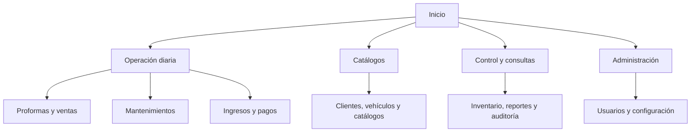
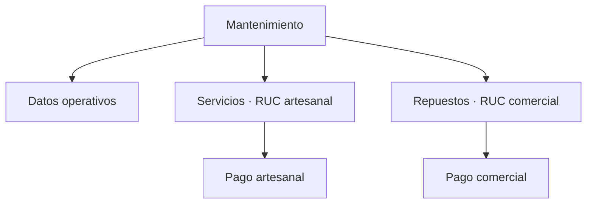

# Requisitos de interfaz y navegación

| Campo | Valor |
|---|---|
| Producto | Sistema de gestión integral para taller automotriz |
| Nombre técnico provisional | Sys-Inventario |
| Versión del documento | 0.2 |
| Estado | Borrador para revisión |
| Fecha | 2026-08-04 |

> Este documento define estructura, pantallas y comportamiento esperado, no un diseño visual definitivo. Los prototipos deberán validar estos requisitos antes de implementar componentes finales.

## 1. Principios de interfaz

1. Mostrar solo módulos y acciones permitidos, sin sustituir la autorización del backend.
2. Usar los términos definidos en `../producto/glosario.md`.
3. Identificar claramente el RUC comercial o artesanal en toda operación económica.
4. Mantener separados estado de venta, estado de pago y estado de facturación.
5. Favorecer búsqueda y selección rápida en los flujos diarios.
6. Evitar la edición destructiva de documentos confirmados; mostrar las acciones de corrección disponibles.
7. Ser adaptable a computadora, tableta y teléfono.
8. Mostrar el efecto de confirmar, anular, devolver o ajustar antes de ejecutar la acción.
9. Conservar contexto al volver desde una ficha a una lista filtrada.
10. No depender únicamente del color para estados, alertas o errores.

## 2. Estructura global

### 2.1 Marco de aplicación

La aplicación autenticada tendrá:

- Encabezado con nombre del producto, usuario actual, acceso a perfil y cierre de sesión.
- Navegación principal lateral en escritorio y contraíble en tableta o teléfono.
- Título de página y ruta de navegación.
- Área principal de contenido.
- Indicador visible de entidad fiscal cuando la pantalla tenga ámbito económico.
- Zona de notificaciones para confirmaciones, advertencias y errores.

### 2.2 Navegación principal propuesta

La presentación exacta puede cambiar durante el prototipado, pero debe evitar una navegación separada y duplicada para los dos RUC. La entidad fiscal se deriva del proceso: repuestos corresponden al RUC comercial y servicios al artesanal.

## 3. Inicio y acceso rápido

### UI-001 — Inicio de sesión

- Usuario o identificador.
- Contraseña con opción para mostrar temporalmente.
- Acción principal “Iniciar sesión”.
- Mensaje genérico para credenciales inválidas.
- Indicación de bloqueo o recuperación administrativa sin revelar si una cuenta específica existe.

### UI-002 — Página de inicio

Debe mostrar únicamente información permitida al usuario:

- Accesos rápidos según rol: nueva venta, nueva proforma, nuevo mantenimiento, nuevo ingreso y registrar pago.
- Alertas de stock bajo para roles autorizados.
- Saldos pendientes separados por RUC para quien pueda consultarlos.
- Mantenimientos registrados pendientes de finalizar.
- Estado básico del respaldo solo para el Administrador.

Los indicadores no deben reemplazar los reportes ni mezclar totales fiscales.

## 4. Patrón de listas

Todas las listas principales deben ofrecer, según el dato:

- Búsqueda de texto con etiqueta clara.
- Filtros combinables y acción para limpiarlos.
- Ordenamiento por columnas pertinentes.
- Paginación del lado del servidor.
- Conteo de resultados.
- Acción primaria visible para crear, si existe permiso.
- Menú de acciones por fila según estado y permiso.
- Estado textual acompañado de distintivo visual.
- Estado vacío que explique qué hacer.
- Estado de carga y error con opción de reintento seguro.
- Exportación solo cuando esté definida para la pantalla.

En teléfono se mostrarán primero identificador, nombre o documento, estado, total y acción principal. Los demás datos podrán aparecer en una vista expandida o ficha.

## 5. Patrón de formularios

- Agrupar campos por significado, no por estructura de base de datos.
- Marcar campos obligatorios antes de enviar.
- Validar formato al salir del campo y reglas completas al guardar.
- Mostrar errores junto al campo y un resumen al inicio cuando existan varios.
- Conservar los valores ingresados después de un error recuperable.
- Advertir antes de abandonar cambios no guardados.
- Diferenciar `Guardar borrador` de `Confirmar`.
- Deshabilitar doble envío mientras se procesa una acción crítica.
- Indicar por qué una acción está deshabilitada cuando sea útil.
- Mostrar importes con moneda y precisión consistentes.

## 6. Pantallas por módulo

### 6.1 Usuarios y configuración

| ID | Pantalla | Contenido y acciones esenciales |
|---|---|---|
| UI-010 | Lista de usuarios | Búsqueda, estado, rol, último acceso cuando esté disponible, crear, editar, activar/desactivar y restablecer credencial. |
| UI-011 | Formulario de usuario | Identificación de acceso, datos básicos, estado y selección de uno o más roles entre Administrador, Vendedor y Encargado del taller. |
| UI-014 | Entidades fiscales | Pestañas o fichas independientes para RUC comercial y artesanal; nunca un formulario económico combinado. |
| UI-015 | Impuestos y vigencias | Lista cronológica por entidad fiscal, tarifa, fecha inicial y final; crear nueva vigencia. |
| UI-016 | Series y secuenciales | Entidad, tipo, serie, valor actual y estado; edición controlada con advertencia. |
| UI-017 | Parámetros | Formas de pago, umbrales y valores configurables aprobados. |
| UI-018 | Auditoría | Filtros por usuario, fecha, acción, tipo, identificador y resultado; detalle de evento. |

### 6.2 Clientes y vehículos

| ID | Pantalla | Contenido y acciones esenciales |
|---|---|---|
| UI-020 | Lista de clientes | Búsqueda por nombre, identificación y contacto; estado; acceso a ficha y creación. |
| UI-021 | Ficha de cliente | Datos, vehículos, saldos separados por RUC e historial permitido. |
| UI-022 | Formulario de cliente | Tipo de persona, identificación y datos definidos por `DP-008`; advertencias de duplicado. |
| UI-023 | Lista de vehículos | Placa, marca, modelo, cliente responsable, estado y último kilometraje. |
| UI-024 | Ficha de vehículo | Datos, responsable vigente, historial cronológico y accesos a mantenimientos. |
| UI-025 | Formulario de vehículo | Placa, VIN y datos definidos; búsqueda previa de duplicados y selección de responsable. |

### 6.3 Productos, servicios y proveedores

| ID | Pantalla | Contenido y acciones esenciales |
|---|---|---|
| UI-030 | Lista de productos | Código, nombre, categoría, marca, precio, existencia autorizada, stock bajo y estado. |
| UI-031 | Ficha de producto | Datos, existencias por bodega, Kardex, precio y costos según permiso, compatibilidades. |
| UI-032 | Formulario de producto | Código, descripción, clasificación, unidad, precios, umbral, tipo kit y compatibilidades. |
| UI-033 | Categorías, marcas y unidades | Gestión de valores maestros y estado. |
| UI-034 | Lista de servicios | Nombre, precio referencial y estado. |
| UI-035 | Formulario de servicio | Nombre, descripción opcional, precio referencial y estado. |
| UI-036 | Lista de proveedores | Identificación, nombre, contacto y estado. |
| UI-037 | Formulario de proveedor | Datos obligatorios y validación de duplicados pertinentes. |

### 6.4 Ingresos e inventario

| ID | Pantalla | Contenido y acciones esenciales |
|---|---|---|
| UI-040 | Lista de ingresos | Secuencial, proveedor, fecha, estado, total, usuario; crear, abrir y filtrar. |
| UI-041 | Editor de ingreso | Encabezado, proveedor, bodega y tabla editable de productos, cantidades y costos; guardar borrador y confirmar. |
| UI-042 | Detalle de ingreso | Datos históricos, movimientos generados, costos aplicados y acción de anulación autorizada. |
| UI-043 | Existencias | Producto, bodega, existencia, umbral y estado de stock; búsqueda y exportación. |
| UI-044 | Kardex | Filtros, saldo inicial, movimientos, saldo final y enlaces al origen. |
| UI-045 | Ajuste de inventario | Producto, bodega, existencia actual, sentido, cantidad, resultado previsto y motivo. |
| UI-046 | Alertas de stock bajo | Productos bajo umbral y acceso a ficha o historial de ingresos. |

### 6.5 Proformas y ventas

| ID | Pantalla | Contenido y acciones esenciales |
|---|---|---|
| UI-050 | Lista de proformas | Número, cliente, emisión, vigencia, total, estado; crear, abrir, convertir o anular según permiso. |
| UI-051 | Editor de proforma | Cliente, vigencia, líneas, precios, descuentos, impuestos y disponibilidad informativa; guardar e imprimir. |
| UI-052 | Detalle de proforma | Valores históricos, estado, venta generada y acciones permitidas. |
| UI-053 | Lista de ventas | Secuencial, cliente, origen, fecha, estado de venta, estado de pago, estado de facturación y total. |
| UI-054 | Editor de venta | Cliente, origen, condición, líneas, permisos de precio/descuento, totales; guardar borrador y confirmar. |
| UI-055 | Detalle de venta | Tres estados independientes, saldos, pagos, Kardex, origen, mantenimiento vinculado y correcciones. |
| UI-056 | Devolución | Venta original, cantidades vendidas y ya devueltas, selección de devolución, motivo y efectos previstos. |
| UI-058 | Comprobante interno comercial | Vista imprimible con RUC comercial, cliente, líneas, totales, estado y aviso fiscal correspondiente. |

### 6.6 Pagos y cuentas por cobrar

| ID | Pantalla | Contenido y acciones esenciales |
|---|---|---|
| UI-060 | Registro de pago | Documento, entidad fiscal destacada, total, pagado, saldo, fecha, formas e importes. |
| UI-061 | Historial de pagos | Pagos válidos y corregidos, forma, importe, usuario y relaciones de anulación. |
| UI-062 | Cuentas por cobrar | Pestañas o filtros independientes Comercial y Artesanal; cliente, documento, antigüedad y saldo. |
| UI-063 | Corrección de pago | Pago original, motivo, efecto y acción trazable; opciones definitivas sujetas a `DP-005`. |

Nunca se debe ofrecer un único botón de cobro que reparta silenciosamente dinero entre los dos RUC. Si un mantenimiento tiene servicios y repuestos pendientes, se mostrarán dos operaciones claramente separadas.

### 6.7 Mantenimientos

| ID | Pantalla | Contenido y acciones esenciales |
|---|---|---|
| UI-070 | Lista de mantenimientos | Identificador, fecha, cliente, vehículo, kilometraje, estado y saldos artesanales permitidos. |
| UI-071 | Editor de mantenimiento | Cliente, vehículo, fecha, kilometraje, diagnóstico, observaciones, servicios, fotografías y repuestos usados. |
| UI-072 | Selector de servicios | Búsqueda en catálogo, precio referencial, cantidad y precio aplicado sujeto a permiso. |
| UI-073 | Fotografías | Carga, miniaturas, descripción opcional, vista ampliada y retiro autorizado. |
| UI-074 | Repuestos utilizados | Selección de productos y cantidades; estado de la venta comercial vinculada; sin descuento directo. |
| UI-075 | Detalle de mantenimiento | Resumen operativo y dos bloques económicos separados: servicios artesanales y repuestos comerciales. |
| UI-076 | Finalizar o cancelar | Lista de validaciones, documentos vinculados, motivo para cancelación y efecto explícito. |
| UI-077 | Comprobante interno artesanal | RUC artesanal, cliente, vehículo, servicios, importes, pagos y aviso fiscal correspondiente. |

Disposición conceptual del detalle:

### 6.8 Reportes y operación

| ID | Pantalla | Contenido y acciones esenciales |
|---|---|---|
| UI-080 | Centro de reportes | Administrador: todos los reportes; Vendedor: comercial e inventario; Encargado del taller: artesanal e inventario. |
| UI-081 | Visor de reporte | Filtros, período, entidad fiscal, tabla, totales, enlace a origen y exportación. |
| UI-082 | Estado operativo | Versión, conectividad de servicios y último respaldo, sin mostrar secretos. |
| UI-083 | Historial de respaldos | Fecha, tipo, resultado, responsable y verificación. |

## 7. Flujos de navegación críticos

### 7.1 Venta directa

`Inicio → Ventas → Nueva venta → Guardar borrador → Revisar → Confirmar → Registrar pago o dejar saldo → Detalle/Imprimir`

### 7.2 Proforma a venta

`Proformas → Nueva/Editar → Emitir → Convertir → Revisar cambios → Venta en borrador → Confirmar`

### 7.3 Ingreso de mercadería

`Ingresos → Nuevo → Proveedor y líneas → Guardar borrador → Confirmar → Detalle → Ver movimientos de Kardex`

### 7.4 Mantenimiento con repuestos

`Mantenimientos → Nuevo → Datos y servicios → Repuestos utilizados → Venta comercial en borrador → Confirmación independiente → Finalizar mantenimiento`

### 7.5 Corrección

`Detalle del documento → Anular o devolver → Revisar efectos → Motivo → Confirmación reforzada → Documento compensatorio`

## 8. Confirmaciones y mensajes

### 8.1 Acciones que requieren confirmación reforzada

- Confirmar ingreso.
- Confirmar venta.
- Confirmar operación económica de servicios.
- Ajustar inventario.
- Anular ingreso, venta, pago u operación de servicios.
- Registrar devolución.
- Cancelar mantenimiento.
- Cambiar series o secuenciales.
- Desactivar usuarios.
- Restaurar un respaldo.

La confirmación debe indicar el objeto, entidad fiscal, efecto principal y motivo obligatorio cuando aplique. El texto del botón debe describir la acción, por ejemplo `Confirmar venta y descontar stock`, no simplemente `Aceptar`.

### 8.2 Tipos de mensaje

| Tipo | Uso |
|---|---|
| Éxito | Acción completada, con acceso al documento creado. |
| Información | Estado o consecuencia sin riesgo inmediato. |
| Advertencia | Decisión revisable: stock cambió, kilometraje menor, proforma vencida. |
| Error de validación | Datos que el usuario puede corregir. |
| Error de conflicto | Otro usuario modificó el recurso o cambió la existencia. |
| Error del sistema | Fallo no recuperable desde el formulario, con identificador de seguimiento. |

## 9. Estados y acciones disponibles

| Objeto | Estado | Acciones habituales |
|---|---|---|
| Ingreso | Borrador | Editar, confirmar, descartar si no tiene efectos. |
| Ingreso | Confirmado | Consultar, imprimir, anular con permiso. |
| Proforma | Editable/vigente | Editar, imprimir, convertir, anular. |
| Proforma | Vencida | Consultar, renovar si se aprueba, anular. |
| Proforma | Convertida | Consultar y abrir venta; no convertir otra vez. |
| Venta | Borrador | Editar, confirmar, descartar. |
| Venta | Confirmada | Consultar, cobrar, devolver, anular, imprimir. |
| Venta | Anulada | Consultar original y compensaciones. |
| Mantenimiento | Registrado | Editar, añadir servicios/fotos/repuestos, finalizar o cancelar. |
| Mantenimiento | Finalizado | Consultar y gestionar documentos económicos permitidos; no editar operación. |
| Mantenimiento | Cancelado | Consultar historial; no generar nuevos cobros. |

Los estados exactos de proforma y facturación interna se cerrarán antes de diseñar la API.

## 10. Comportamiento adaptable

### Escritorio

- Navegación lateral expandida.
- Tablas con columnas relevantes y paneles de resumen.
- Formularios de dos columnas cuando su lectura no se deteriore.

### Tableta

- Navegación contraíble.
- Formularios de una o dos columnas según orientación.
- Acciones críticas siempre visibles sin depender del puntero.

### Teléfono

- Navegación en panel o menú compacto.
- Formularios de una columna.
- Filas de tabla convertidas en tarjetas o vista de columnas prioritarias.
- Barra de acciones fija solo cuando no tape contenido ni teclado.
- No exigir gestos sin alternativa visible.

## 11. Impresión y exportación

- Las proformas y comprobantes internos deben tener vista específica de impresión A4.
- Cada documento debe mostrar la entidad fiscal correcta y no mezclar conceptos de la otra.
- Debe indicar estado (`BORRADOR`, `ANULADO`, etc.) cuando corresponda.
- Mientras no exista facturación electrónica, debe aclarar que el documento interno no constituye una factura electrónica autorizada.
- Las exportaciones tabulares deben incluir los filtros y fecha de generación o mantenerlos en metadatos visibles.

## 12. Decisiones de interfaz pendientes

| Decisión | Pantallas afectadas |
|---|---|
| `DP-001` Una o varias bodegas | UI-041, UI-043, UI-044, UI-045. |
| `DP-002` Stock negativo | UI-054, UI-056, UI-074 y mensajes de conflicto. |
| `DP-003` Formas de pago | UI-017, UI-060, UI-061. |
| `DP-004` Descuentos | UI-051, UI-054, UI-072 y flujo de autorización. |
| `DP-005` Reembolsos y saldos a favor | UI-056, UI-057, UI-063. |
| `DP-006` Formatos de secuencial | UI-016 y todos los documentos imprimibles. |
| `DP-007` Reapertura | UI-075, UI-076 y acciones por estado. |
| `DP-008` Campos obligatorios | UI-022 y UI-025. |

## 13. Validación mediante prototipos

Antes de cerrar el diseño visual se deben prototipar y revisar al menos:

1. Venta directa con cobro y con crédito.
2. Mantenimiento con servicios y repuestos separados.
3. Confirmación de ingreso y visualización de costo promedio.
4. Devolución parcial y anulación con pagos existentes.
5. Uso de las pantallas principales en 360 px, tableta y escritorio.
6. Visibilidad y navegación correctas para Administrador, Vendedor y Encargado del taller.
