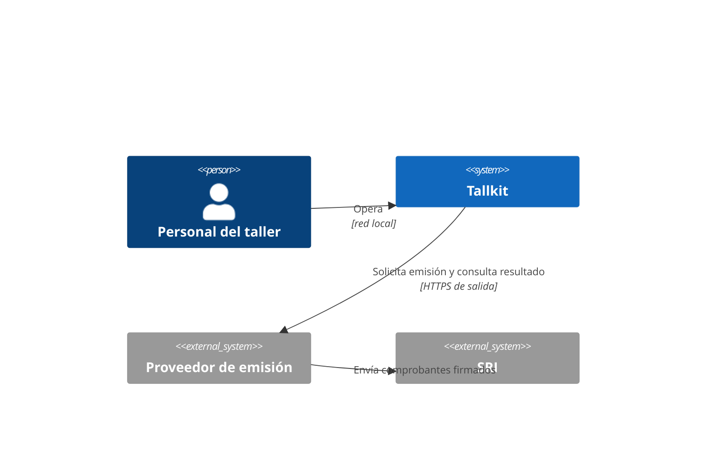

## Context

Este cambio registra `DP-034` y sincroniza la documentación. No toca código, así que este diseño decide cómo ordenar los documentos y no cómo programar la emisión.

Estado comprobado en el código:

- `backend/src/fiscal/application/identity.py:90` rechaza numerar fuera de pruebas, con prueba en `backend/tests/sales/test_fiscal_identity.py`.
- `backend/src/fiscal/api/serializers.py:428` solo admite el ambiente `TEST` en el estado fiscal.
- `backend/src/fiscal/application/xml_archive.py:174` bloquea incorporar un XML de producción sin política y restauración.
- Ningún archivo de `backend/` ni `frontend/src/` nombra a un proveedor de emisión.

La regla de transición de `DP-034` es cierta hoy: esos bloqueos siguen activos sin modificar nada.

## Goals / Non-Goals

**Goals:**

- Registrar `DP-034` respetando la precedencia de las fuentes.
- Crear la matriz de normas con identificadores que los cambios 2 a 7 puedan citar.
- Dejar cada requisito nuevo asignado a su cambio, sin presentarlo como implementado.
- Poder comprobar el resultado con búsquedas repetibles.

**Non-Goals:**

- Definir la interfaz del proveedor, la cola de emisión o los estados de emisión: cambio 3 y `ADR-0013`.
- Modificar specs fiscales distintas de `modelo-dominio-taller`.
- Modificar `docs/arquitectura/modelo-datos.md`.
- Verificar todas las normas antes de archivar: la spec admite filas pendientes.

## Decisions

### D1. `DP-034` sigue el formato de las sustituciones anteriores

`DP-034` se agrega después de `DP-033` en `decisiones-confirmadas.yaml`. `DP-018` recibe la marca «(sustituida en parte por DP-034)» y conserva su texto, igual que `DP-022` frente a `DP-030`.

En el mismo archivo se reemplaza el límite «No incluir facturación electrónica real ni conexión con el SRI» y se retira «y facturación electrónica» de las decisiones no cerradas, conservando consumidor final.

*Alternativa descartada:* reescribir `DP-018`. Borraría la historia de la decisión.

### D2. La matriz va en `docs/negocio/requisitos/`

La ruta es `docs/negocio/requisitos/matriz-normas-facturacion-electronica.md`, con su referencia de glosario.

Cada fila lleva un identificador estable `NOR-001`, que se agrega a las convenciones de `matriz-trazabilidad.md`. Los cambios de emisión citan ese identificador. Una fila sustituida conserva el suyo.

| ID | Norma o documento | Tema | Qué exige | Fuente | Consultada | Cambio | Estado |
|---|---|---|---|---|---|---|---|

*Alternativa descartada:* `docs/tecnico/`. Las normas limitan a los requisitos y esa carpeta tiene menor precedencia.

*Distinción:* `docs/tecnico/matriz-instantanea-fiscal.md` compara campos del comprobante. La nueva matriz compara obligaciones legales. Ninguna reemplaza a la otra.

### D3. Las normas se resumen solo desde su fuente

Al aplicar el cambio se intentará obtener cada texto oficial. Lo que no se pueda leer queda Pendiente, indicando qué falta. Lo conocido por el plan o por el proveedor se registra como fuente secundaria.

Archivar este cambio no exige filas verificadas. Sí exige que cada tema mínimo tenga fila.

*Alternativa descartada:* resumir de memoria para completar la matriz. Daría por cierta una obligación legal sin leerla.

### D4. Identificadores nuevos

Se usan los siguientes números disponibles, sin renumerar nada.

| ID | Contenido | Cambio responsable |
|---|---|---|
| `RN-FIS-015` | V1 emite factura y nota de crédito y anula, mediante un proveedor de emisión | 3 y 7 |
| `RN-FIS-016` | Tallkit no firma ni custodia la firma; cambiar de proveedor no toca la operación | 3 y 4 |
| `RN-FIS-017` | Cada entidad se activa por separado y cumple sus condiciones | 3 y 4 |
| `RN-FIS-018` | Prueba real supervisada | 4 |
| `RF-FIS-008` | Emitir una factura desde una operación confirmada | 3 y 4 |
| `RF-FIS-009` | Mostrar el estado de emisión y reintentar sin duplicar | 3 |
| `RF-FIS-010` | Conservar copia propia del XML y el RIDE | 3 |
| `RF-FIS-011` | Entregar el comprobante al comprador | 5 |
| `RF-FIS-012` | Emitir notas de crédito y registrar anulaciones | 7 |
| `RF-FIS-013` | Activar la facturación por entidad fiscal | 3 y 4 |
| `RNF-DIS-009` | Sin Internet la operación continúa y el comprobante espera | 3 |
| `RNF-COM-007` | La emisión no depende de un proveedor específico | 3 |
| `CU-031` | Emitir un comprobante electrónico, a alto nivel | 3 |

La trazabilidad los registra como pendientes, con esos cambios.

### D5. Ajustes con condición y no con borrado

Lo que se ajusta conserva su texto y agrega hasta cuándo rige:

- `RF-FIS-003` y `RN-FIS-012`: solo pruebas hasta habilitar la emisión.
- `RN-FIS-014` y `RF-FIS-006`: añaden la excepción de la prueba real, y siguen bloqueando la facturación diaria.
- `RNF-DIS-001`: aclara que solo la emisión necesita Internet.
- `CU-003` 5d: rechazar producción rige hasta habilitar la emisión.

Los documentos permanentes citan «cambios 3 y 4 de `docs/cambios-pendientes.md`». No usan el nombre `conectar-emision-factuplan`, porque nombra al proveedor.

### D6. `ADR-0010` recibe una sección «Actualización»

Sigue el formato de `ADR-0005`, conserva su estado y su texto original. Indica que `DP-034` incluye la emisión en V1, que la integración sigue fuera de las transacciones comerciales y que `ADR-0013` queda para el cambio 3.

*Alternativa descartada:* crear ahora `ADR-0013`. Aún no hay estructura técnica que decidir, y se escribiría antes de conocer el diseño de la emisión.

### D7. Solo cambia el C4 de contexto

`docs/architecture/c4-context.md` agrega al proveedor y al SRI como sistemas externos, con conexión únicamente de salida.

`c4-containers.md` no cambia: describe lo que se ejecuta hoy, y esa conexión aún no existe. Se actualiza en el cambio 3.

### D8. `ReferenciaFiscalFutura` pasa a `ReferenciaFiscal`

El cambio de nombre afecta al modelo de dominio: §3, §5.3, §7, diagrama y §13. El concepto no existe en el código, por lo que no hay impacto técnico.

Los estados de ese concepto no se tocan. El modelo y la regla de independencia del plan usan listas distintas, y la decisión corresponde al cambio 3. El modelo agrega §11.8 y su fila de trazabilidad, sin clases nuevas.

### D9. Criterio de aceptación de V1

`alcance-v1.md` §9 agrega un criterio: la emisión funciona para las dos entidades con el adaptador simulado, y cada entidad activada obtiene una factura real autorizada.

Así los dos RUC siguen dentro de V1, pero el comercial no frena al artesanal.

### D10. Sincronización por documento

| Documento | Cambio | Salida |
|---|---|---|
| `decisiones-confirmadas.yaml` | D1 | Reemplaza |
| `vision.md` §12, §13, §14 | Retira «fase posterior» y su riesgo | Reemplaza |
| `alcance-v1.md` §1, §2, §6, §7, §9, §10 y extensión final | Incluye la emisión y cierra `FUT-001` | Reemplaza |
| `reglas-negocio.md` | D4, D5, `RN-CON-010` sin «futura» y §12 | Reemplaza y ajusta |
| `requisitos-funcionales.md` | D4, D5, `RF-VEN-009`, `RF-REP-014` y §13 | Reemplaza y ajusta |
| `requisitos-no-funcionales.md` | D4 y `RNF-DIS-001` | Ajusta |
| `casos-de-uso.md` | `CU-031` y `CU-003` 5d | Ajusta |
| `actores-y-roles.md` §7 | Permisos pendientes de los cambios 3 y 7 | Se aplaza |
| `interfaz-y-navegacion.md` §9 y §11 | Quita «futuro»; conserva el aviso mientras no exista emisión | Ajusta |
| `glosario.md` y `glosario-tecnico.md` | Términos nuevos y pares de confusión | Reemplaza |
| `modelo-dominio.md` | D8 | Reemplaza |
| `c4-context.md` | D7 | Reemplaza |
| `ADR-0010` | D6 | Se ajusta |
| `operacion-archivo-fiscal.md` | Nota de la prueba real, que aún no opera | Se ajusta |
| `matriz-instantanea-fiscal.md` | «Fuera de alcance» pasa a ser de esa matriz | Se ajusta |
| `matriz-trazabilidad.md` | `NOR-*`, requisitos pendientes y fila de documentos | Reemplaza |
| `docs/cambios-pendientes.md` | Redondeo en el cambio 2, prueba real en el cambio 4 y casillas | Reemplaza |

Sin cambios: `openspec/config.yaml` y las reglas de documentos internos, porque se mantienen; `cobertura-modulo-fiscal.md`, porque es evidencia de un cambio anterior; y `modelo-datos.md`.

El orden de edición sigue la precedencia: decisión, producto, requisitos, arquitectura y plan. Una inconsistencia a mitad del trabajo queda siempre en la fuente inferior.

### Impacto por área

| Área | Impacto |
|---|---|
| Backend, frontend, datos y API | Ninguno. |
| Seguridad y permisos | Ninguno. Los permisos de emisión se aplazan. |
| Operación | Ninguno. Producción sigue rechazada. |
| Transacciones, concurrencia e idempotencia | No aplican: no hay escrituras. |

### Verificación

No hay código, así que no aplican formato, lint, tipos, pruebas, cobertura, build ni migraciones.

- `openspec validate incorporar-facturacion-electronica-en-v1 --strict`.
- `git diff --stat` solo muestra archivos `.md`, el YAML de decisiones y los artefactos del cambio.
- Búsqueda de `factuplan` y `ruxi`: solo en la decisión, el plan y este cambio.
- Búsqueda de frases como «fase posterior», «referencia fiscal futura» y «fuera de V1»: cada resultado se corrige o se justifica.
- Comprobación de los enlaces nuevos y de las referencias de glosario.

## Risks / Trade-offs

- [Requisitos escritos antes de implementarse] → Constan como pendientes en la trazabilidad, con su cambio responsable.
- [Documentos que dicen «sigue bloqueado» y código que lo confirma] → Es la transición prevista. Cada texto indica hasta cuándo rige.
- [Las specs conservan frases sobre «futura» emisión] → Las specs de otras capacidades no se tocan. `operacion-artesanal-de-servicios` y `ADR-0008` siguen citando la referencia futura hasta su propio cambio, y la verificación lo justifica.
- [La excepción de la prueba real no existe en el código] → `xml_archive.py:174` bloquearía sus XML. El cambio 3 o el 4 debe programarla antes de emitir; la nota de D10 lo advierte.
- [Dos sentidos de «proveedor»] → El glosario agrega el par «Proveedor / Proveedor de emisión».
- [Muchos documentos en un cambio] → El orden de D10 y las búsquedas finales reducen olvidos.

## Migration Plan

No hay datos ni despliegue. Si la decisión se revierte antes de los cambios siguientes, basta con revertir sus commits. Después de archivar, una reversión exige una decisión nueva que sustituya a `DP-034`.

## Open Questions

- **Lista de estados de la referencia fiscal:** el modelo y el plan difieren. Se decide en el cambio 3.
- **Fecha y plazo del comprobante que esperó sin Internet:** se resuelve en la matriz antes del diseño del cambio 3.
- **Registro del desarrollador ante el SRI:** se resuelve en la matriz antes de la prueba real.
- **Disponibilidad de los textos oficiales:** si el sitio del SRI no los entrega, sus filas quedan pendientes y el titular deberá conseguirlos.
